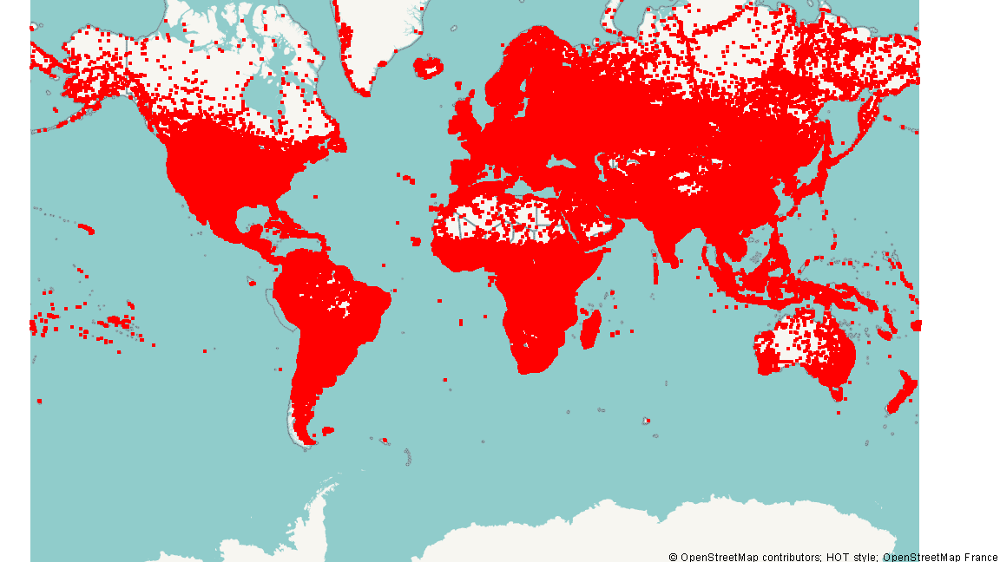

# Kong Kin Meng — Data Science Portfolio

Hi, I'm **Kong Kin Meng** (mc65281), a data science student at the **University of Macau**. This site showcases my data science projects, built with Python and Jupyter Notebooks.

## Skills
- Python (pandas, numpy)
- Data analysis & visualization (matplotlib, seaborn, geoplotlib)
- Geospatial data analysis
- Machine learning basics (linear & ridge regression, scikit-learn)

## Projects

### Global City Population Visualization
**Status:** Completed · CISC7204 course project (Activity 8.01)

**Research question:** How are the world's cities distributed geographically, and what does the distribution of large cities (population > 100,000) reveal about regional urbanization patterns?

Using `geoplotlib`, this project maps ~3.17 million city records from the GeoNames world cities database (bundled with the geoplotlib package). It renders dot-density maps of all cities, aggregates city counts by country, builds a Voronoi diagram for cities with a population above 100,000, and applies a Delaunay triangulation to the large cities of Germany and Great Britain.

**Key findings:**
- The sample covers 234 countries with a mean of ~13,564 records per country — it is a sample, not a full census.
- Only 3,527 city records report a population above 100,000; these concentrate in Europe and Asia.
- Germany and Great Britain form dense Delaunay networks of large cities, reflecting high urbanization.

**Repository:** [CISC7204-mc652817-2026GitHub → Tutorial08-Cities](https://github.com/kongkinmeng/CISC7204-mc652817-2026GitHub/tree/main/Tutorial08-Cities)

---

*Built with GitHub Pages. Last updated: October 2026.*
